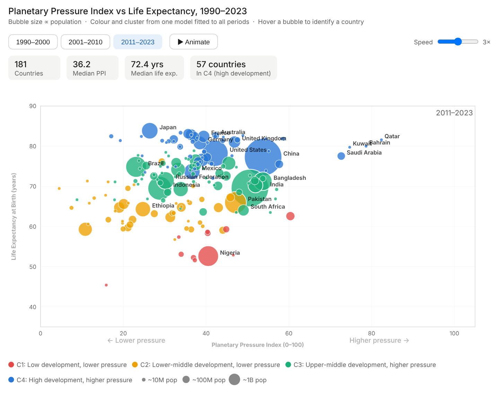

# Planetary Boundary Transgressions and Divergent Socio-Economic Pathways

**A cross-national quantitative analysis of planetary pressure and development, 1990–2023**

[](https://github.com/sahiljangra12/Thesis/actions/workflows/ci.yml)

Undergraduate thesis · BSc Analytics and Sustainability Studies · Tata Institute of Social Sciences, Mumbai (2026)
Author: Sahil · Supervisor: Dr. Kamal Kumar Murari

[](https://sahiljangra12.github.io/Thesis/)

**[Open the interactive chart →](https://sahiljangra12.github.io/Thesis/)**

## Research question

Do countries that place more pressure on planetary boundaries achieve better socio-economic outcomes, and how have countries moved between pressure–development pathways since 1990?

## Data

The sample is **182 countries**: the 193 UN member states plus the State of Palestine, keeping those with a mean population of at least 100,000. The panel runs from 1990 to 2023, and its indicators come from the World Bank World Development Indicators, FAOSTAT, the WHO Global Health Observatory, ILOSTAT and the UNDP Human Development Report. Years are grouped into three non-overlapping periods: 1990–2000, 2001–2010 and 2011–2023.

See [`data/README.md`](data/README.md) for files, variables and provenance.

## Method

1. **Planetary Pressure Index (PPI).** Six indicators: renewable energy share and forest cover (both reversed), agricultural land, fertiliser use, PM2.5 exposure and energy use per capita. Each is z-scored over all country-periods, the six are averaged (at least 4 must be present), and the result is rescaled to a single 0–100 scale shared by every period.
2. **Clusters.** One k-means model (K = 4) is fitted to all country-periods together. It uses PPI, log GDP per capita, life expectancy, infant mortality and urbanisation. Clusters are numbered by development level and named from their centres.
3. **Transitions.** For each pair of consecutive periods, the analysis counts how many countries moved from one cluster to another. Because the clusters are shared, a move reflects a real change in the country's indicators.
4. **Associations.** Bivariate OLS of each outcome on the PPI, by period. These describe co-variation, not causal effects.

## Key results

| Cluster | Description | PPI | Life expectancy | GDP per capita |
|---|---|---|---|---|
| C1 | Low development, lower pressure | 30 | 53 yrs | ~$500 |
| C2 | Lower-middle development, lower pressure | 27 | 65 yrs | ~$1,250 |
| C3 | Upper-middle development, higher pressure | 37 | 71 yrs | ~$4,000 |
| C4 | High development, higher pressure | 44 | 78 yrs | ~$25,000 |

*Cluster centres. GDP per capita is the exponential of the mean log value.*

- **Development and pressure rise together.** In every period, a higher PPI goes with higher income, longer life expectancy, lower infant mortality and more urbanisation (all p < 0.05). The association weakens over time; the correlation with life expectancy, for example, falls from 0.40 in 1990–2000 to 0.25 in 2011–2023.
- **Female labour-force participation runs the other way.** It is consistently lower where the PPI is higher (r ≈ −0.34 to −0.37). The PPI has no association with unemployment.
- **Countries move up, and pressure follows.** About 70% of countries stay in the same cluster from one period to the next. Almost every move is upward (48 of 49 moves from the 1990s to the 2000s, and all 53 from the 2000s to 2011–2023). The step from C2 to C3, the most common move from lower- to higher-pressure development, happened 36 times.
- **Global average pressure is roughly flat.** The mean PPI is 35.2, 35.0 and 35.6 across the three periods. Rising pressure in developing countries is offset elsewhere.
- **Silhouette is about 0.25 at K = 4.** The clusters overlap, so they should be read as a typology rather than sharply separated groups.

All tables are in [`results/`](results/): the workbook `thesis_results.xlsx`, plus one CSV per table in `results/csv/`.

## Changes from the submitted version

Version 2.0 corrects several problems in the analysis that was submitted in 2026. These include aggregates and territories that had entered the sample, a per-period PPI scale, and clusters that were fitted separately for each period. The submitted version is preserved on the branch [`v1.0-submitted`](https://github.com/sahiljangra12/Thesis/tree/v1.0-submitted). What changed and why is documented in [`docs/method-changes.md`](docs/method-changes.md).

## Repository structure

```
src/ppi_pathways/    Analysis package: data, PPI, clustering, regression, figures, pipeline
notebooks/           thesis_analysis.ipynb: step-by-step walkthrough using the package
tests/               Checks on the sample, the PPI, the clusters and the regressions
data/                Input panel, country list, region lookup, source documentation
results/             Generated tables (xlsx + csv)
figures/             Generated figures
docs/                Interactive chart (GitHub Pages) and method notes
```

## Reproducing the analysis

```bash
git clone https://github.com/sahiljangra12/Thesis.git
cd Thesis
pip install -e ".[dev]"
python -m ppi_pathways        # regenerates results/, figures/ and docs/data/ in a few seconds
pytest                        # runs the checks
```

On every push, continuous integration runs the linter and the tests. It then reruns the whole analysis and fails if any committed result changes.

## Citation

Use **"Cite this repository"** in the GitHub sidebar, or the details in [`CITATION.cff`](CITATION.cff).

## License

Code is released under the [MIT License](LICENSE). The data comes from the public sources listed above and remains subject to their terms.
