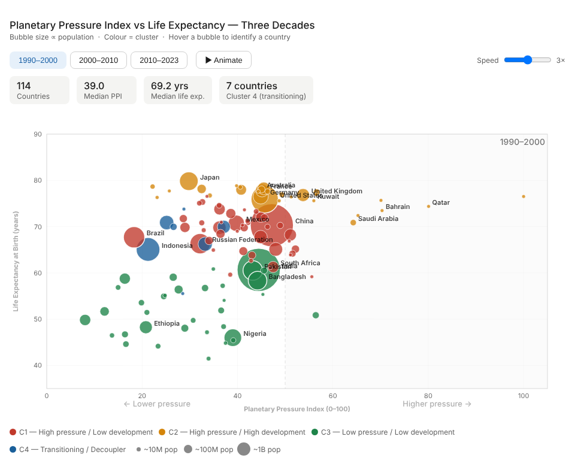

# Planetary Boundary Transgressions and Divergent Socio-Economic Pathways

**A cross-national quantitative analysis of environmental pressure and development, 1990–2023**

Undergraduate thesis · BSc Analytics and Sustainability Studies · Tata Institute of Social Sciences, Mumbai (2026)
Author: Sahil · Supervisor: Dr. Kamal Kumar Murari



**[Interactive version →](https://sahiljangra12.github.io/Thesis/)** Step through the three decades and watch countries move.

## Research question

Do countries that put more pressure on planetary boundaries also achieve better socio-economic outcomes? How have countries moved between pressure-and-development pathways over three decades?

## Data

The analysis uses a country–year panel of 195 sovereign countries (regional aggregates and countries under 100,000 people removed), covering 1990–2024 with 50 variables. Sources are the World Bank World Development Indicators, FAOSTAT, the WHO Global Health Observatory, ILOSTAT and the UNDP Human Development Report. All are open access.

Years are grouped into three periods: **D1** 1990–2000, **D2** 2000–2010 and **D3** 2010–2023.

## Method

1. **Planetary Pressure Index (PPI).** Six indicators: renewable energy share, forest cover, agricultural land, fertilizer use, PM2.5 exposure and energy use per capita. Renewables and forest cover are sign-reversed so that higher always means more pressure. Each indicator is z-scored globally, the six are averaged (a country needs at least 4 of 6), and the result is rescaled to 0–100 within each decade.
2. **Clustering.** K-means on PPI, GDP per capita, life expectancy, infant mortality and urbanization. K = 4 was chosen using the elbow method and silhouette scores (0.31–0.33), and clusters were labeled by their position relative to the median PPI and GDP:
   - C1: high pressure / low development
   - C2: high pressure / high development
   - C3: low pressure / low development
   - C4: transitioning / decoupling
3. **Transitions.** Matrices showing how countries moved between clusters from D1 to D2 and from D2 to D3.
4. **Regression.** Bivariate OLS of each socio-economic outcome on PPI, run separately for each decade.

## Key results

- Mean PPI rose in every period: 34.9 → 37.6 → 39.9.
- Higher planetary pressure goes with better development outcomes in every decade: higher life expectancy, lower infant mortality and more urbanization (all p < 0.05). The link weakens over time. For example, the correlation with life expectancy falls from r = 0.40 in the 1990s to 0.25 in 2010–2023.
- Higher pressure is associated with *lower* female labor-force participation in every decade. PPI has no relationship with unemployment.
- 91% of countries stayed in the same cluster from the 1990s to the 2000s.

Full tables are in [`results/thesis_results.xlsx`](results/thesis_results.xlsx).

## Repository structure

```
data/
  thesis_dataset.xlsx      Analysis panel (Data sheet) and variable dictionary (Legend sheet)
  data_sources.xlsx        Source links, indicator mapping and master database
notebooks/
  thesis_analysis.ipynb    Full analysis, from raw panel to tables and figures
results/
  thesis_results.xlsx      Descriptive statistics, cluster profiles, assignments, regressions, transitions
figures/                   Figures written by the notebook
docs/
  index.html               Interactive animation (served by GitHub Pages)
```

## Reproducing the analysis

```bash
git clone https://github.com/sahiljangra12/Thesis.git
cd Thesis
pip install -r requirements.txt
cd notebooks
jupyter nbconvert --to notebook --execute --inplace thesis_analysis.ipynb
```

The notebook runs end to end in under a minute and reproduces the PPI summary, silhouette scores, transition matrices and regression results in `results/thesis_results.xlsx`.

## Citation

If you use this work, please cite it using the details in [`CITATION.cff`](CITATION.cff), or use **"Cite this repository"** in the GitHub sidebar.

## License

Code is released under the [MIT License](LICENSE). The data comes from the public sources listed above and remains subject to their terms.
